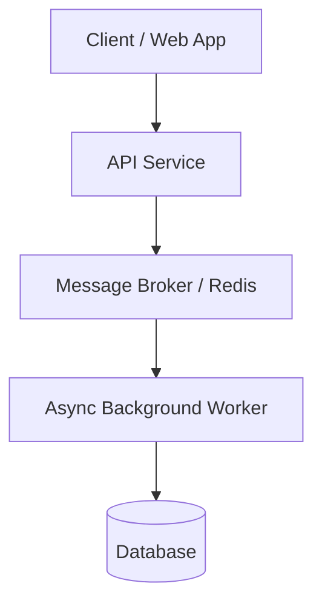

# Scaffold & Architecture Templates

Use these templates when generating the Phase 2 Markdown scaffold.

## 1. Image Placeholder Template

Wherever a screenshot, UI capture, or diagram is needed, insert:

```markdown

*Caption: <Brief reader-facing caption explaining the key takeaway>*
<!-- IMAGE PLACEHOLDER:
- Description: <What this image depicts, key UI elements, metrics, or annotations to highlight>
- Capture / Creation Guide: <Instructions for taking the screenshot/chart, or a generation prompt for Vertex AI Studio / Figma>
-->
```

## 2. Adaptive Architecture Options

Choose the best fit for the `## Architecture & Mental Model` section:

### Option A: Ready-to-Render Mermaid Diagram
- Supported types: `flowchart TD`, `flowchart LR`, `sequenceDiagram`, `stateDiagram-v2`, `erDiagram`.
- Always wrap node labels containing punctuation, parentheses, or brackets in double quotes (e.g., `id["API Gateway (Express)"]`).
- Avoid raw HTML in node labels.



### Option B: Vertex AI Studio / Image Generation Prompt
```markdown

<!-- 
IMAGE GENERATION PROMPT (Vertex AI Studio / Image Tool):
"A clean, minimalist 2D isometric technical diagram showing a client web application connecting to a modern microservices gateway, routing tasks to a Redis queue and asynchronous worker nodes with a PostgreSQL database. Flat vector illustration, clean lines, white background, developer documentation aesthetic."
-->
```

### Option C: Conceptual Comparison Table / Mental Model
| Pattern / Layer | Role & Responsibility | Key Trade-off |
| :--- | :--- | :--- |
| **Worker Pool** | Parallel CPU-bound processing | Higher memory footprint |
| **Event Stream** | Decoupled asynchronous messaging | Eventual consistency |

### Option D: Omit
Skip the architecture anchor for quick tips, opinion pieces, or short debugging logs.
