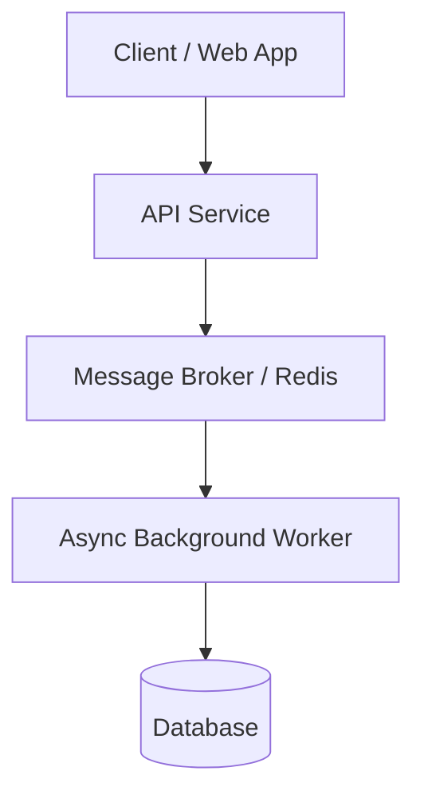

# Scaffold & Architecture Templates

Use these templates when generating the Phase 2 Markdown scaffold.

## 1. Image Placeholder Template

Wherever a screenshot, UI capture, or diagram is needed, insert:

```markdown

*Caption: <Brief reader-facing caption explaining the key takeaway>*
<!-- IMAGE PLACEHOLDER:
- Description: <What this image depicts, key UI elements, metrics, or annotations to highlight>
- Capture / Creation Guide: <Instructions for taking the screenshot/chart, or a generation prompt for Vertex AI Studio / Figma>
-->
```

## 2. Adaptive Architecture Options

Choose the best fit for the `## Architecture & Mental Model` section:

### Option A: Ready-to-Render Mermaid Diagram

- Supported types: `flowchart TD`, `flowchart LR`, `sequenceDiagram`, `stateDiagram-v2`, `erDiagram`.
- Always wrap node labels containing punctuation, parentheses, or brackets in double quotes (e.g., `id["API Gateway (Express)"]`).
- Avoid raw HTML in node labels.



### Option B: Vertex AI Studio / Image Generation Prompt

```markdown

<!-- 
IMAGE GENERATION PROMPT (Vertex AI Studio / Image Tool):
"A clean, minimalist 2D isometric technical diagram showing a client web application connecting to a modern microservices gateway, routing tasks to a Redis queue and asynchronous worker nodes with a PostgreSQL database. Flat vector illustration, clean lines, white background, developer documentation aesthetic."
-->
```

### Option C: Conceptual Comparison Table / Mental Model

| Pattern / Layer | Role & Responsibility | Key Trade-off |
| :--- | :--- | :--- |
| **Worker Pool** | Parallel CPU-bound processing | Higher memory footprint |
| **Event Stream** | Decoupled asynchronous messaging | Eventual consistency |

### Option D: Omit

Skip the architecture anchor for quick tips, opinion pieces, or short debugging logs.

## 3. Interleaved Code Walkthroughs (Method-by-Method Slicing)

When walking through a class, service, or module with multiple methods (or long methods):

- **Never dump all method explanations at the top followed by one giant class block at the bottom**, which forces readers to scroll up and down to connect the prose to the code.
- **Interleave explanation and code slices**:
  1. Introduce class dependencies/signals followed by the class header & fields snippet.
  2. For each method (`1. methodA()`, `2. methodB()`, etc.), place the bullet explanation immediately followed by that single method's code block.

## 4. High-Signal Code Excerpts & Prompt Focus (No Boilerplate Noise)

Code blocks in technical blog posts are pedagogical excerpts, not raw file dumps. Regardless of language (TypeScript, Go, Python, Rust, Swift, Kotlin, etc.) or platform (Web, Backend, Mobile/iOS/Android, CLI), strip low-signal boilerplate from both code snippets and `<!-- PROMPT: ... -->` blocks:

1. **Strip Module Headers & Framework Wiring Metadata:**
   - Omit top-of-file `import`/`use`/`package` blocks unless a specific import (e.g., type-only vs. dynamic import) is central to the point.
   - Omit routine annotations, decorators, macros, or registration metadata that merely link files or register a class/handler with the framework.
2. **Strip Defensive Wrappers, Error-State Plumbing, and Logging:**
   - Unless error handling or observability is the explicit subject of the section, strip routine `try/catch` blocks, repetitive error checks (`if err != nil`), UI error/loading state resets, and telemetry/logging calls so only the core domain or state-transition logic remains.
3. **Strip Visual Layout, Styling Modifiers, and Static Display Data:**
   - Do **not** dump full view files, stylesheets, layout containers, decorative styling modifiers (CSS classes, mobile UI layout chains/modifiers), or static display collections/copy. Excerpt only the interactive, reactive, or data-bound lines under discussion.
4. **Focus Prompts on Architectural & Non-Obvious Mechanics Only:**
   - Never instruct the author to explain every line of code.
   - Highlight only pivotal engineering decisions, runtime/lifecycle constraints, concurrency or DI boundaries, and state flows.
